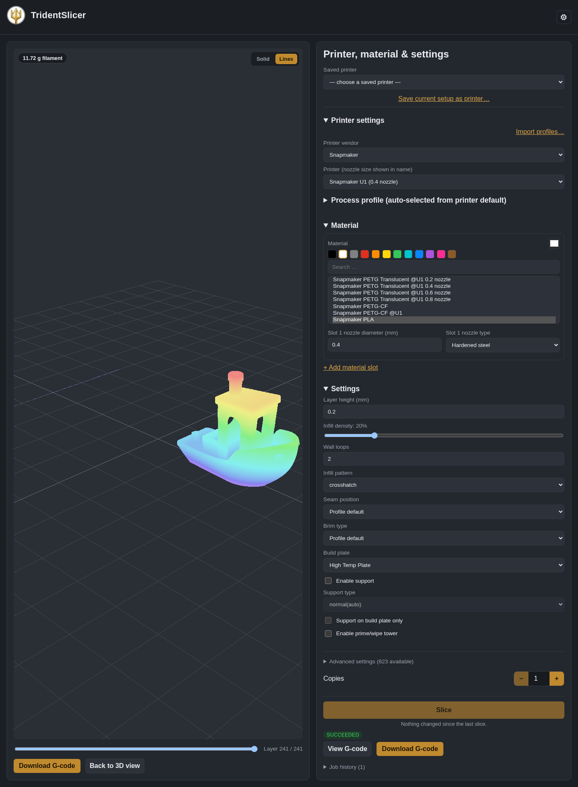
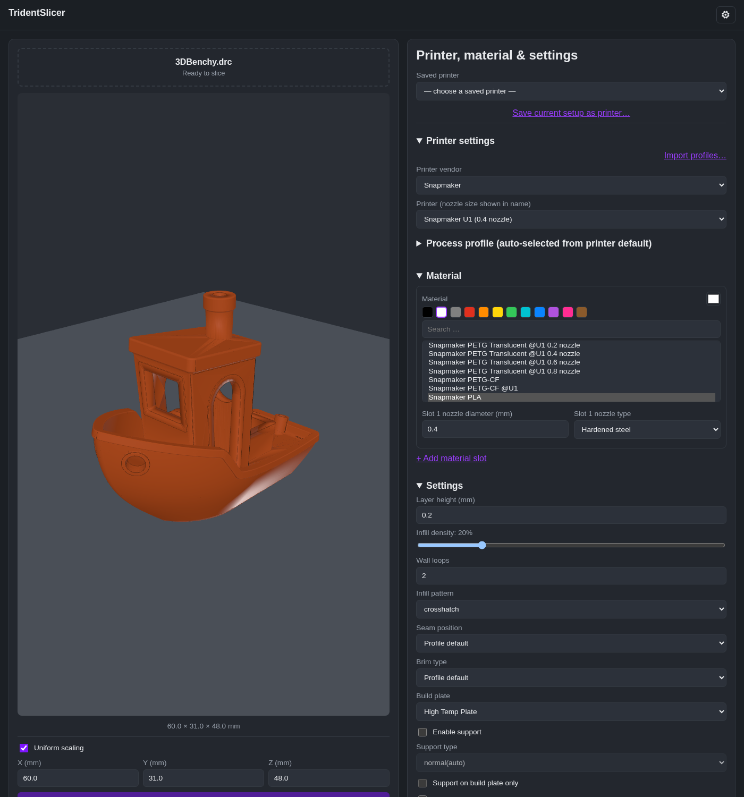
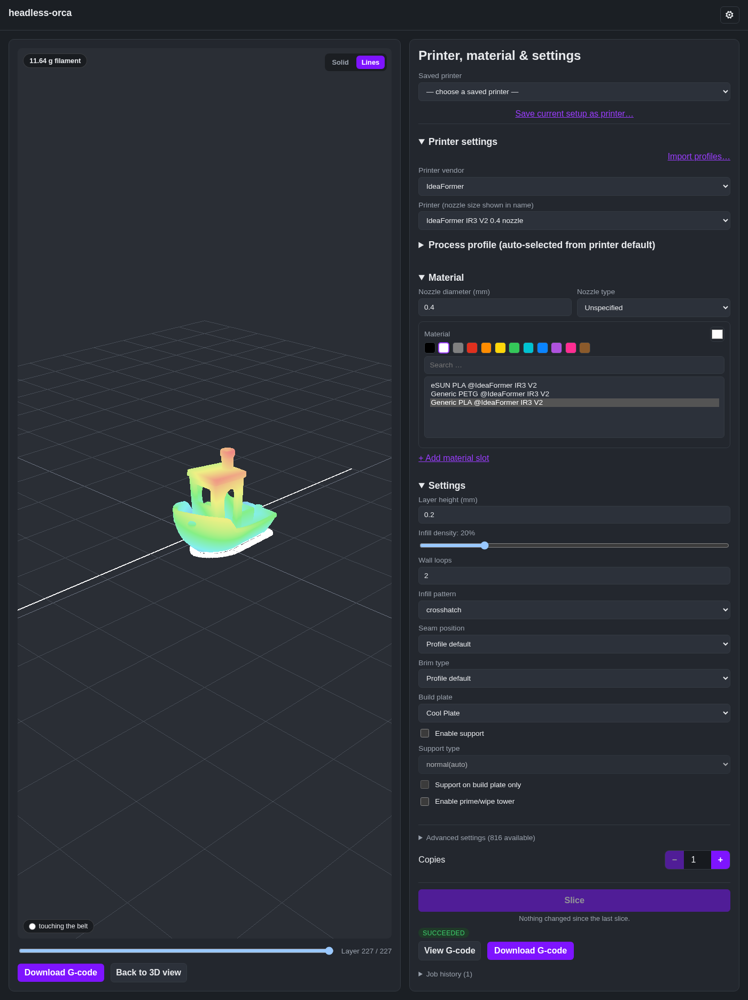

<p align="center">
  
</p>

<h1 align="center">Trident Studio</h1>

<p align="center">
  <b>A self-hosted slicer for your server.</b><br>
  OrcaSlicer's slicing engine, run headless in Docker, with a web UI you can use from any browser or phone.
  Works with the printers OrcaSlicer supports, and with belt printers as a bonus.

<p align="center">
  <a href="https://ko-fi.com/mugenoesis"></a>
</p>

</p>
<p align="center">
https://www.youtube.com/watch?v=1vSq-iEaazE
</p>

<p align="center">
  
</p>

## What it does

Upload a model, pick a printer and material, slice, preview the G-code layer by layer, and download it or send it
straight to your printer. It runs on a NAS or home server, so you can slice from your phone, or from a
machine that has no slicer installed.

- **Your printer is probably already in it.** OrcaSlicer's whole printer, filament and process library is built in,
  from 70+ vendors (Bambu Lab, Prusa, Creality, Snapmaker, Voron, Elegoo, Anycubic, Qidi, Sovol and many more). You can
  also import your own profiles (`.json`, `.zip`, `.orca_printer`, `.orca_filament`, `.orca_bundle`).
- **Make your own printers.** A printer that isn't in the list: copy one (or start from nothing, or a generic Marlin, Klipper, RRF, Repetier or belt printer) and set the bed, nozzle, firmware, start and end G-code and motion, with every other printer setting a search away on the Advanced tab. Belt printers can be endless or have a real length. You can export your printers and materials for desktop OrcaSlicer. A Klipper printer can fill the form in itself: **Read it from a Klipper printer** takes its address (and an API key if Moonraker wants one) and reads its own config through Moonraker, read-only. It fills in the bed, nozzle, speeds, retraction and the end macro (and the start line when the start macro takes temperatures), marks each value as read from the printer, says where each came from, and lists what to check (a toolchanger's travel is bigger than its bed, a macro that takes no temperatures is not guessed at). Nothing is saved until you save the printer; the same read is `POST /printers/klipper-import`.
- **Make your own materials.** Create a new material from any existing one with a short form (temperatures, bed
  temperature per plate, flow, fan); everything else is inherited, and any other material setting is a search away on the Advanced tab, and you choose whether it is for the current printer only or for every printer.
- **Multi-material and tool changers.** Assign a file's colours to nozzles and slice multi-colour models, including
  4-head printers like the Snapmaker U1. The build plate list only offers plates your chosen filament supports.
- **Multi-plate 3MF files.** Preview each plate, slice any plate, and choose which objects in a file to print, with
  thumbnails so you can tell them apart.
- **Rotate and move.** A preview of your plate with sliders to place the model and to turn it on each axis, plus
  "Lay flat" and "Pick a face" (choose the face that should sit on the plate in a window of its own, and the plate is
  see-through so you can pick the underside). Works for 3MF files too. For a file with several objects, pick one and
  turn or move it while the others stay greyed out; Apply writes them all together, and overlaps are flagged. With a
  multi-plate file it works on the plate you have picked and leaves the other plates alone.
- **Scale, auto-orient, auto-arrange and copies.** Scale the model, let the slicer orient or arrange it, and print
  several copies.
- **Mesh check.** STL files are checked on upload for the defects the slicer repairs, and holes it cannot repair are
  flagged before they become a bad print.
- **Resin (MSLA) printers.** Switch to **Resin** to slice for resin printers: pick one of the 150+ in the catalogue (Elegoo, Anycubic, Creality, Phrozen, FlashForge, UniFormation and more), pick a resin from the built-in library of published exposure and lift settings (each with its source), listed for the printer you picked: a resin with no settings for it is not offered (tick "Also show resins with no settings for this printer" to start from a resin made for another printer: its bottom and transition layers carry over, the exposure is left for you with the other printer's numbers as a hint, and "Make my own resin based on this config…" keeps the result for your printer), adjust them, set supports, pad and hollowing, and download the file your printer reads (.ctb, .goo, .pwmb, ...). Look at the layers as the printer will expose them (a slider through the sliced layers). Bring in a resin profile from another slicer (a Chitubox .cfg or a PrusaSlicer .ini) with Import a resin file…; it is saved as resins of your own. Make your own resin printer when yours is not in the list: copy one from the catalogue or start from its screen size, pixel counts, build height and file format; the numbers are checked (a printer rejects a file that does not match its screen). Give a bottle price and size and the result shows what the print cost in resin (the price and size are kept with a resin of your own). A layer too big to peel easily from the film (over 20 cm², our rule of thumb) gets a warning. Save the exposure and lift values on screen as a resin of your own (listed under "My resins", private to your account). Save a resin setup (printer, resin and slice settings) as a saved printer; saved printers are listed in FDM and Resin groups. The slicer can write most of those formats; printers whose format it cannot write yet are listed and marked. None of the formats has been checked on a real printer yet, so please report what works.
- **Send to your printer.** Upload the G-code to a Moonraker (Klipper, Mainsail, Fluidd) or OctoPrint printer.
- **Bambu Lab printers.** Save a Bambu printer with its IP address, serial number and access code (all on its screen). In **Developer Mode** (which needs LAN Only mode first and takes the printer off Bambu Cloud until you turn both off) it appears on the Printers page like a Klipper one (state, progress, layers, time left, temperatures, **Pause**, **Resume** and **Cancel**, and its camera), and a print sliced for a Bambu machine can be sent to it: Trident uploads the sliced 3MF to the printer's storage by FTPS and, if you ask, starts it over MQTT (optionally from the AMS's first slot). Tick **Monitor only** for a printer that is not in Developer Mode: it is watched and never sent a command (pause, resume, cancel), and a sliced print can be sent to its storage and started on the printer itself. That upload was tried on an X1 Carbon, a P1S and an A1 mini in ordinary cloud mode and the file arrived on all three (the P1S and A1 mini never send the final "transfer complete" reply, so Trident checks that the whole file is there). Developer Mode control is tested against a fake printer only, and whether status and camera work for a printer in cloud mode is unconfirmed: please report what a real X1, P1 or A1 does. Each Bambu card has a **Raw status** view (without the serial number, address or code) for finding out what a printer reports.
- **Bambu printers in cloud mode (experimental).** With `ORCA_API_EXPERIMENTAL_BAMBU_CLOUD=1`, add the printers on your Bambu account (signing in on Bambu's own page) and start prints on them without Developer Mode, through Bambu's own network plug-in. See [Bambu printers left in cloud mode](#bambu-printers-left-in-cloud-mode-experimental) for how to turn it on, how to use it, and its limits.
- **Watch your printers.** The **Printers** button in the header opens a page with a card for each saved printer that has a Klipper (Moonraker) address: its state (printing, paused, finished, error, offline), the file, progress with layers and an estimate of the time left, every nozzle, the bed and the chamber temperature, and its webcam (a picture renewed about once a second, through Trident, so the printer's address and key stay on the server). **Pause**, **Resume** and **Cancel** (which asks first) are all the page can do to a printer. The page asks the printers only while it is open (`GET /printers/{id}/status`, `POST /printers/{id}/print/{pause|resume|cancel}`, `GET /printers/{id}/webcams`).
- **Every setting is reachable.** The common ones (layer height, infill, walls, seam, brim, supports, build plate) are
  up front, and all 800+ OrcaSlicer settings are under Advanced. Saved printers and settings profiles keep your setups.
- **Works on a phone.** Responsive single-page app, installable as a PWA. There is also an HTTP API with Swagger docs
  at `/docs`.
- **Single-user or multi-user.** Run it just for yourself with no login, or switch to accounts.
- **API keys.** Another program can use Trident without a login: make a key in the settings menu (the cog, **API keys…**).
  A **Holecraft** key may only upload models, so a program such as [Holecraft](https://github.com/mugenoesis/holecraft) can
  send a design here and open it (the page opens at `/?model=<id>`); a **Holecraft resin tools** key may also have models hollowed (`POST /resin/hollow`: a wall of 0.5 to 20 mm, answered with the hollow model as an STL) and ask for the support points the slicer would use (`POST /resin/supports`, answered as JSON) and see the list of resin printers (`GET /resin/printers`) and the resin printers you have saved (`GET /resin/saved-printers`), which is what Holecraft's Hollow and support-editing tools use; a model given points (`PUT /models/<id>/support-points`, the points moved or added to) is printed with exactly those supports unless the job sets `hand_placed_supports` to false; a **full-access** key may use every API. A key is shown
  once when you make it, only a hash is stored, and it can be revoked at any time. Send it as `Authorization: Bearer <key>`.

<p align="center">
  
</p>

### Bonus: belt printers

Belt (conveyor) printers such as the IdeaFormer IR3 V2 work too, which most slicers can't do well. Trident adds tree
supports that grow down to the belt, a flat pad at the belt, purge-line alignment so the print starts right at the
purge, and an endless-length bed. You can line several objects up along the belt and drag them into print order.

<p align="center">
  
</p>

### Bambu printers left in cloud mode (experimental)

A Bambu printer normally has to go into LAN Only and Developer Mode before anything but Bambu's own software can start a print on it, which takes it off Bambu Cloud. This experiment lets Trident use a printer that stays in ordinary cloud mode, through Bambu's own network plug-in (the same one Bambu Studio and OrcaSlicer load), not by getting round it. It is off unless you turn it on, and it has been tried on an X1 Carbon, a P1S and an A1 mini.

**Turn it on** by giving the container `ORCA_API_EXPERIMENTAL_BAMBU_CLOUD=1`: `-e ORCA_API_EXPERIMENTAL_BAMBU_CLOUD=1` in `docker run`, `environment:` in Compose, or **Add another Path, Port, Variable** in Unraid's container settings. Without it none of this shows, and the plug-in is never downloaded.

**Use it**
1. Printer settings → **Save current setup as printer** → **Add from Bambu account**. The first time, Trident downloads Bambu's plug-in from Bambu (the 02.08.04 series, which can start prints).
2. **Sign in** opens Bambu's own sign-in page in your browser. Trident never sees your password. Bambu only sends the browser back to `localhost`, so the tab ends on an address that will not load: copy that address and paste it into the box (on a phone, `localhost` is the phone, so paste the address it ends on all the same).
3. Your account's printers are listed. Trident finds each one's address by reading the serial number in the certificate each printer shows on its MQTT port, on your own network: the /24 around the address you opened Trident from (you can search another, up to a /22). Only a TLS handshake is made; no password goes to any address. Printers answer in about a second each.
4. **Add** saves each printer with its serial number, access code, the matching catalogue profiles and its address, as **monitor only**.
5. Slice for it and press **Send to …**. Untick **Start printing immediately** to put the file on the printer and start it from its screen (this works for everyone, with no experiment). Tick it to have the plug-in send the file and start it. The printer must be idle with storage in it, on the same network as Trident. The AMS box prints from the AMS (filament *n* from slot *n*); otherwise from the spool on the back.

**What stays private:** the access code and serial number stay on the server (the browser sees the model, name, state and address). Sign-in tokens live for one call. Bambu's plug-in keeps its own saved sign-in in `orcaslicer-datadir/bambu-session` so that sending does not ask for a paste each time.

**Limits, so you are not surprised**
- Bambu's server currently refuses to record the print as a task (HTTP 403). The plug-in then sends the file over your network, which is what Bambu Studio does when the cloud route fails, and the print starts. We have not checked whether such a print appears in Bambu's own history.
- How long the saved sign-in lasts is not known: if sending says you are not signed in, sign in again under **Add from Bambu account**.
- Filament mapping is basic: one filament, or filament *n* on AMS slot *n*, with no colour matching.
- The cover picture of a job is Trident's 3D preview, so it appears when you slice in the web page (not through the API alone).
- The plug-in is Bambu's closed software under Bambu's terms. Trident does not ship it: it is downloaded from Bambu, to your data folder, only when you use the section. A small helper program in the image (`api/helper/bbl_session.cpp`, built in the Docker image's first stage) loads it the way Orca does. Nothing in this section sets a client name or identity for Bambu's server.
- **Please report** what your own printer does, including its model and firmware.

## Install

Trident is one container. It needs port 8000 and three folders to keep your data.

### Docker

```bash
docker run -d --name trident --restart unless-stopped \
  -p 8000:8000 \
  -v /path/to/trident/models:/data/models \
  -v /path/to/trident/output:/data/output \
  -v /path/to/trident/orcaslicer-datadir:/data/orcaslicer-datadir \
  mugenoesis/trident:latest
```

Then open `http://<your-server>:8000/`. The first visit asks whether it's just you (no login) or several people.

> **Security:** in single-user mode there is no login, so anyone who can reach port 8000 can use Trident, see your models and use your saved printers. Keep it on your home network. Before exposing it to the internet, switch on multi-user mode (accounts) and put it behind an HTTPS reverse proxy.

### Docker Compose

```yaml
services:
  trident:
    image: mugenoesis/trident:latest
    container_name: trident
    restart: unless-stopped
    ports:
      - "8000:8000"
    volumes:
      - ./data/models:/data/models                    # uploaded models
      - ./data/output:/data/output                    # sliced G-code, jobs, saved printers and settings
      - ./data/orcaslicer-datadir:/data/orcaslicer-datadir
```

### Unraid

Open the **Apps** tab, search for "Trident" and click **Install**. The template maps port 8000 and stores everything
under `/mnt/user/appdata/trident/`. The template lives in
[mugenoesis/unraid-templates](https://github.com/mugenoesis/unraid-templates).

### Notes

- **Architecture:** the image is `linux/amd64` only.
- **Size:** about 1.4 GB on disk (about 560 MB to download).
- **Your data** lives only in the three mounted folders; the container itself keeps nothing.
- **Optional experiment:** `ORCA_API_EXPERIMENTAL_BAMBU_CLOUD=1` turns on the Bambu cloud-mode features (see [Bambu printers left in cloud mode](#bambu-printers-left-in-cloud-mode-experimental)). It is off by default.
- **Exposing it outside your network:** see the security note above (multi-user mode and an HTTPS reverse proxy).

## Build it yourself

```bash
git clone --recurse-submodules https://github.com/mugenoesis/Trident.git
cd Trident
docker build -f docker/Dockerfile -t trident \
  --build-arg ORCASLICER_COMMIT_SHA=$(git -C vendor/orcaslicer rev-parse HEAD) .
```

The first build compiles OrcaSlicer from source and takes a long time (about an hour on a fast machine). Pass
`--build-arg BUILD_JOBS=<n>` to limit how many cores it uses. Later builds reuse the cached layers.

## Developing

```bash
cd api
python3 -m venv .venv && .venv/bin/pip install -e ".[dev]"
.venv/bin/pytest                          # mocked, no OrcaSlicer binary needed
.venv/bin/uvicorn app.main:app --reload   # http://localhost:8000/docs
```

Without a real `orca-slicer` binary the slicing endpoints degrade gracefully, which is handy for working on the API.
The web app lives in [`web/`](web/README.md). The design is in [`docs/ARCHITECTURE.md`](docs/ARCHITECTURE.md).

### Code quality checks

AI coding sessions: read [`AGENTS.md`](AGENTS.md) first.


The real-slicer API tests run in an engine image with `scripts/slicer-tests.sh <image>`.

One gate runs everything CI runs: `scripts/check.sh` (or `scripts/check.sh web` / `api`). A host with no Python can run the
Python tools through `scripts/py.sh`, a throwaway container, for example `scripts/py.sh ruff check app`.

| Area | Tools |
|---|---|
| Web | [Biome](https://biomejs.dev) (format, lint, cognitive complexity), [knip](https://knip.dev) (unused code and dependencies), `tsc` |
| API | [black](https://black.readthedocs.io) (format), [ruff](https://docs.astral.sh/ruff) (lint, security, imports), [pyright](https://github.com/microsoft/pyright) (types), [complexipy](https://github.com/rohaquinlop/complexipy) (cognitive complexity), [vulture](https://github.com/jendrikseipp/vulture) (dead code), pytest with a coverage floor |
| Both | `scripts/audit.sh` (known vulnerabilities in what ships), `scripts/docker-lint.sh` (hadolint and trivy on the Dockerfile), Dependabot |

Format with `npm run format` in `web/` and `black app tests tests_slicer` in `api/`. Every function is held to a cognitive
complexity of 15 (Biome in the web app, complexipy in the API): when one goes over, split it into smaller pieces. Run `git config blame.ignoreRevsFile .git-blame-ignore-revs` so `git blame` skips the reformat commits.

```
Trident/
├── vendor/orcaslicer/   # git submodule: the patched OrcaSlicer fork
├── docker/              # multi-stage Dockerfile and entrypoint
├── api/                 # FastAPI service
├── web/                 # React/Vite web app
├── docs/                # architecture and AGPL notes
└── scripts/             # the check gate, audits, smoke tests and helpers
```

## Support the project

Trident is free and I build it in my spare time. If it saves you time or gets your printer printing, you can
[buy me a coffee on Ko-fi](https://ko-fi.com/mugenoesis). Bug reports and ideas are welcome as GitHub issues.

## License and credits

Trident is licensed under the [GNU Affero General Public License v3.0](LICENSE). Copyright (C) 2026 mugenoesis.

It is built on [OrcaSlicer](https://github.com/OrcaSlicer/OrcaSlicer) (AGPL-3.0), which descends from Bambu
Studio, PrusaSlicer and Slic3r. This project is not affiliated with or endorsed by any of them. The slicer inside the
container is a patched fork (see `vendor/orcaslicer`, a git submodule). If you use a hosted instance over a network,
you are entitled to the corresponding source:

- Pseudorca, the patched OrcaSlicer fork: <https://github.com/mugenoesis/Pseudorca/tree/headless-orca>
- This repository: <https://github.com/mugenoesis/Trident>

The exact commit the running container was built from is shown by the app's `/source` and `/version` endpoints.
See [`docs/AGPL-COMPLIANCE.md`](docs/AGPL-COMPLIANCE.md).
